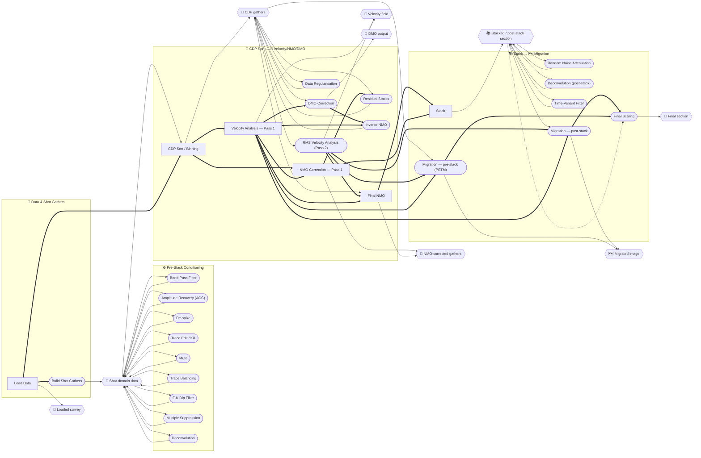

# Operations reference

> **Generated** from `modules/registry.py` by `python -m modules.registry_docs` — do not edit by hand; change the registry and regenerate (`tests/test_registry.py` fails if this file is out of date).

Every operation is declared once in the registry. This page is the whole declaration, rendered. Four things are kept apart (see `docs/DEPENDENCY_MODEL.md`): **required inputs** (⛔ the operation cannot run without them), **recommendations** (⚠ a warning, never a block), the **recommended order** (the order of this page — advice only) and what has actually been done (the data states and the action log).

## Kinds of data

| Kind | Name | What it is |
|---|---|---|
| `raw` | 📂 Loaded survey | The loaded survey (SEG-Y or synthetic): traces and headers, before any processing. |
| `shot` | 🔧 Shot-domain data | Traces grouped by shot (field record) — the domain of pre-stack conditioning. |
| `cdp` | 🔀 CDP gathers | Traces grouped by common-depth-point ensemble, with their offsets — the domain of velocity analysis, NMO, residual statics, DMO and pre-stack migration. |
| `velocity` | 🎯 Velocity field | A stacking-velocity field V(t, CDP) from a velocity analysis. |
| `nmo` | 📐 NMO-corrected gathers | CDP gathers after moveout correction, with a mask of the samples kept — ready to stack. |
| `dmo` | 📐 DMO output | CDP gathers after the (simplified) dip-moveout correction. |
| `section` | 📚 Stacked / post-stack section | A stacked section (CDP × time), or a post-stack-processed version of it. |
| `image` | 🗺️ Migrated image | A migrated section (post-stack or pre-stack time migration). |
| `final` | 🏁 Final section | The final-scaled section. |

## Operations in the recommended order

| Step | Operation | Category | Produces | Required input | Optional |
|---|---|---|---|---|---|
| 1 | [Load Data](#op-upload) | Data loading & organisation | `raw` | — |  |
| 1 | [Build Shot Gathers](#op-shot_gathers) | Data loading & organisation | `shot` | **data**: raw | yes |
| 2 | [Band-Pass Filter](#op-bandpass) | Filtering | `shot` | **data**: shot | yes |
| 3 | [Amplitude Recovery (AGC)](#op-agc) | Gain & scaling | `shot` | **data**: shot | yes |
| 4a | [De-spike](#op-despike) | Trace & sample editing | `shot` | **data**: shot | yes |
| 4b | [Trace Edit / Kill](#op-trace_edit) | Trace & sample editing | `shot` | **data**: shot | yes |
| 5 | [Mute](#op-mute) | Trace & sample editing | `shot` | **data**: shot | yes |
| 6 | [Trace Balancing](#op-balance) | Gain & scaling | `shot` | **data**: shot | yes |
| 7 | [F-K Dip Filter](#op-fk) | Filtering | `shot` | **data**: shot | yes |
| 8 | [Multiple Suppression](#op-mult_supp) | Deconvolution | `shot` | **data**: shot | yes |
| 9 | [Deconvolution](#op-decon) | Deconvolution | `shot` | **data**: shot | yes |
| 10 | [CDP Sort / Binning](#op-cdp_sort) | Data loading & organisation | `cdp` | **data**: shot or raw |  |
| 11 | [Velocity Analysis — Pass 1](#op-vel1) | Velocity analysis | `velocity` | **data**: cdp |  |
| 12 | [NMO Correction — Pass 1](#op-nmo1) | Moveout correction | `nmo` | **data**: cdp; **velocity**: velocity |  |
| 13 | [Residual Statics](#op-statics) | Statics | `cdp` | **data**: cdp; **nmo**: nmo | yes |
| 14 | [DMO Correction](#op-dmo) | Moveout correction | `dmo` | **data**: cdp; **velocity**: velocity | yes |
| 15 | [Inverse NMO](#op-inv_nmo) | Moveout correction | `cdp` | **data**: dmo; **velocity**: velocity | yes |
| 15b | [Data Regularisation](#op-data_reg) | Regularisation | `cdp` | **data**: cdp | yes |
| 16 | [RMS Velocity Analysis (Pass 2)](#op-vel2) | Velocity analysis | `velocity` | **data**: cdp | yes |
| 17 | [Final NMO](#op-nmo_final) | Moveout correction | `nmo` | **data**: cdp; **velocity**: velocity |  |
| 18 | [Stack](#op-stack) | Stacking | `section` | **data**: nmo |  |
| 19 | [Random Noise Attenuation](#op-rna) | Filtering | `section` | **data**: section | yes |
| 20 | [Deconvolution (post-stack)](#op-decon_post) | Deconvolution | `section` | **data**: section | yes |
| 21 | [Time-Variant Filter](#op-tvf) | Filtering | `section` | **data**: section | yes |
| 22 | [Migration — post-stack](#op-migration-poststack) | Migration | `image` | **data**: section; **velocity**: velocity | yes |
| 22 | [Migration — pre-stack (PSTM)](#op-migration-pstm) | Migration | `image` | **data**: cdp; **velocity**: velocity | yes |
| 23 | [Final Scaling](#op-final_scale) | Gain & scaling | `final` | **data**: image or section | yes |

## Data flow

Rounded boxes are optional operations. Solid arrow into an operation: it reads the *current* state of that kind of data; dotted: a less-preferred alternative; thick: it needs the output of that specific operation.

## Each operation

### Load Data 

`upload` · step 1 · Data loading & organisation · not optional · in the app: *Data Management → ① Load data*

Loads a SEG-Y file or generates the synthetic test survey. The survey is state S0 of a session; its size, sample interval and a digest of the trace data are recorded so a recorded recipe can verify that it is replayed on the same data.

- **Produces:** `raw` (Loaded survey)
- **Requires:** nothing.
- **Hard dependencies (named operations):** —
- **Recommended after:** —
- **Recommended before:** —

| Parameter | Type | Default | Unit | Limits | |
|---|---|---|---|---|---|
| `source` | text | *required* |  |  | Where the data came from. *fixed by the application* |
| `traces` | int | *required* |  |  | Number of traces. *fixed by the application* |
| `samples` | int | *required* |  |  | Samples per trace. *fixed by the application* |
| `dt` | float | *required* | s |  | Sample interval. *fixed by the application* |
| `digest` | text | *required* |  |  | Digest of the trace data. *fixed by the application* |

### Build Shot Gathers 

`shot_gathers` · step 1 · Data loading & organisation · optional · in the app: *Data Management → ⑥ Build shot gathers*

Groups the traces by shot (the SEG-Y FieldRecord number) so conditioning can be applied shot by shot. Optional: the CDP sort can read the raw survey directly, e.g. for data that were already conditioned.

- **Produces:** `shot` (Shot-domain data)
- **Requires (data):** a loaded survey — from Load Data output.
- **Hard dependencies (named operations):** Load Data
- **Recommended after:** —
- **Recommended before:** —

| Parameter | Type | Default | Unit | Limits | |
|---|---|---|---|---|---|
| `n_min_traces` | int | `1` | traces | ≥ 1 | Shots with fewer traces are dropped. |

### Band-Pass Filter 

`bandpass` · step 2 · Filtering · optional · in the app: *Pre-Stack Conditioning → Band-Pass*

Zero-phase trapezoidal band-pass: a linear taper below the low-cut and above the high-cut, smoothed with a Hann kernel to avoid Gibbs ringing, applied to every trace by convolution in the time domain.

- **Produces:** `shot` (Shot-domain data)
- **Requires (data):** shot gathers — from the current Shot-domain data. Pre-stack conditioning runs on shot gathers.
- **Hard dependencies (named operations):** —
- **Recommended after:** —
- **Recommended before:** Amplitude Recovery (AGC), Multiple Suppression, Deconvolution, CDP Sort / Binning
- **Warnings it can raise:**
    - *order inversion* — Band-Pass Filter is normally applied before amplitude recovery (AGC), multiple suppression, deconvolution and CDP sort; running it on data that already went through them applies it out of order.

| Parameter | Type | Default | Unit | Limits | |
|---|---|---|---|---|---|
| `fmin` | float | `12.0` | Hz | ≥ 0 | Low-cut frequency. |
| `fmax` | float | `75.0` | Hz | > 0 | High-cut frequency; must be below the data's Nyquist frequency. |
| `low_slope` | float | `6.0` | Hz | ≥ 0 | Width of the taper below the low-cut. |
| `high_slope` | float | `12.0` | Hz | ≥ 0 | Width of the taper above the high-cut. |

### Amplitude Recovery (AGC) 

`agc` · step 3 · Gain & scaling · optional · in the app: *Pre-Stack Conditioning → Amplitude Recovery*

Sliding-window automatic gain control: every sample is divided by a running RMS, mean or median of the trace amplitude. It is self-normalising, so it equalises amplitudes along each trace and between traces.

- **Produces:** `shot` (Shot-domain data)
- **Requires (data):** shot gathers — from the current Shot-domain data. Pre-stack conditioning runs on shot gathers.
- **Hard dependencies (named operations):** —
- **Recommended after:** Band-Pass Filter
- **Recommended before:** Multiple Suppression, Deconvolution, CDP Sort / Binning
- **Changes each trace's gain** (amplitude-based detection must look upstream of it).
- **Warnings it can raise:**
    - *missing recommended* — AGC amplifies everything in the trace, including out-of-band noise, so the gain is driven by the useful reflection band only if the data were filtered first.
    - *order inversion* — Amplitude Recovery (AGC) is normally applied before multiple suppression, deconvolution and CDP sort; running it on data that already went through them applies it out of order.
    - *caveat* — Not amplitude-preserving: after AGC every trace sits at a similar level, so energy-based trace-kill detection measures the data from before the AGC.

| Parameter | Type | Default | Unit | Limits | |
|---|---|---|---|---|---|
| `window` | int | `250` | samples | ≥ 1 | Length of the sliding gain window. |
| `mode` | choice | `'rms'` |  | rms / mean / median | Statistic of the amplitude in the window. |

### De-spike 

`despike` · step 4a · Trace & sample editing · optional · in the app: *Pre-Stack Conditioning → De-spike*

Flags samples whose amplitude exceeds a threshold times the local robust noise level and that are also isolated in time, and replaces them with the local median. The isolation test keeps genuine sharp reflection wavelets from being mistaken for spikes.

- **Produces:** `shot` (Shot-domain data)
- **Requires (data):** shot gathers — from the current Shot-domain data. Pre-stack conditioning runs on shot gathers.
- **Hard dependencies (named operations):** —
- **Recommended after:** —
- **Recommended before:** CDP Sort / Binning
- **Warnings it can raise:**
    - *order inversion* — De-spike is normally applied before CDP sort; running it on data that already went through them applies it out of order.

| Parameter | Type | Default | Unit | Limits | |
|---|---|---|---|---|---|
| `window` | int | `15` | samples | ≥ 1 | Sliding-median window. |
| `threshold` | float | `6.0` | × noise level | > 0 | Amplitude, as a multiple of the local robust noise level, above which an isolated sample is a spike. |

### Trace Edit / Kill 

`trace_edit` · step 4b · Trace & sample editing · optional · in the app: *Pre-Stack Conditioning → Trace Edit/Kill*

Zeroes (rather than deletes, which would disturb offset and CDP bookkeeping) dead traces — energy far below the gather median — and abnormally noisy ones — energy far above it. The kill mask is measured on amplitude-preserving data (the state just before the first AGC or trace balancing in the data's history) and applied to the data being edited; the state it was measured on is recorded as the extra input 'detect'.

- **Produces:** `shot` (Shot-domain data)
- **Requires (data):** shot gathers — from the current Shot-domain data. Pre-stack conditioning runs on shot gathers.
- **Hard dependencies (named operations):** —
- **Recommended after:** —
- **Recommended before:** CDP Sort / Binning
- **Also records the input:** detect
- **Warnings it can raise:**
    - *order inversion* — Trace Edit / Kill is normally applied before CDP sort; running it on data that already went through them applies it out of order.
    - *caveat* — Detection is energy-based and blind after a per-trace gain; the application measures upstream of AGC / balancing automatically.

| Parameter | Type | Default | Unit | Limits | |
|---|---|---|---|---|---|
| `dead_frac` | float | `0.02` | × median | ≥ 0 | A trace whose energy is below this fraction of the median is dead. |
| `noisy_mult` | float | `8.0` | × median | ≥ 0 | A trace whose energy exceeds this multiple of the median is noisy. |

### Mute 

`mute` · step 5 · Trace & sample editing · optional · in the app: *Pre-Stack Conditioning → Mute*

Three kinds. Flat: a cosine-tapered top mute, the same time on every trace. Linear: an offset-dependent (linear-moveout) mute that zeroes each trace before t0 + |offset| / velocity, following a direct arrival or ground-roll cone. Surgical: zeroes a rectangular offset–time box inside the gather.

- **Produces:** `shot` (Shot-domain data)
- **Requires (data):** shot gathers — from the current Shot-domain data. Pre-stack conditioning runs on shot gathers.
- **Hard dependencies (named operations):** —
- **Recommended after:** —
- **Recommended before:** Deconvolution, CDP Sort / Binning
- **Warnings it can raise:**
    - *order inversion* — Mute is normally applied before deconvolution and CDP sort; running it on data that already went through them applies it out of order.

| Parameter | Type | Default | Unit | Limits | |
|---|---|---|---|---|---|
| `kind` | choice | `'flat'` |  | flat / linear / surgical | Which mute to apply. |
| `t_top` | float | `0.05` | s | ≥ 0 | Time above which every trace is muted. (only for kind = flat) |
| `velocity` | float | `500.0` | m/s | > 0 | Apparent velocity of the muted event. (only for kind = linear) |
| `t0` | float | `0.0` | s |  | Intercept time of the mute line. (only for kind = linear) |
| `x_min` | float | `0.0` | m |  | Smallest \|offset\| of the muted box. (only for kind = surgical) |
| `x_max` | float | `0.0` | m |  | Largest \|offset\| of the muted box. (only for kind = surgical) |
| `t_min` | float | `0.0` | s |  | Start time of the muted box. (only for kind = surgical) |
| `t_max` | float | `0.0` | s |  | End time of the muted box. (only for kind = surgical) |
| `taper` | float | `0.05` | s | ≥ 0 | Cosine taper at the edge of the mute. |

### Trace Balancing 

`balance` · step 6 · Gain & scaling · optional · in the app: *Pre-Stack Conditioning → Trace Balancing*

Divides each trace by a single RMS scalar measured in a reference window from t = 0. A per-trace scalar, distinct from the sliding-window AGC: relative amplitudes within a trace are preserved.

- **Produces:** `shot` (Shot-domain data)
- **Requires (data):** shot gathers — from the current Shot-domain data. Pre-stack conditioning runs on shot gathers.
- **Hard dependencies (named operations):** —
- **Recommended after:** —
- **Recommended before:** CDP Sort / Binning
- **Changes each trace's gain** (amplitude-based detection must look upstream of it).
- **Warnings it can raise:**
    - *order inversion* — Trace Balancing is normally applied before CDP sort; running it on data that already went through them applies it out of order.
    - *caveat* — Removes between-trace amplitude differences, so energy-based trace-kill detection measures the data from before it.

| Parameter | Type | Default | Unit | Limits | |
|---|---|---|---|---|---|
| `ref_s` | float | `1.5` | s | > 0 | Length of the reference window, from t = 0. |

### F-K Dip Filter 

`fk` · step 7 · Filtering · optional · in the app: *Pre-Stack Conditioning → F-K Filter*

Transforms each shot gather to the F-K domain, multiplies it by a polygon mask and transforms back. Accept mode: the polygon encloses the signal and everything outside it is attenuated. Reject mode: the polygon encloses the noise. Amplitudes on the wrong side are scaled by a small coefficient rather than an exact zero.

- **Produces:** `shot` (Shot-domain data)
- **Requires (data):** shot gathers — from the current Shot-domain data. Pre-stack conditioning runs on shot gathers.
- **Hard dependencies (named operations):** —
- **Recommended after:** —
- **Recommended before:** Deconvolution, CDP Sort / Binning
- **Warnings it can raise:**
    - *order inversion* — F-K Dip Filter is normally applied before deconvolution and CDP sort; running it on data that already went through them applies it out of order.
    - *caveat* — Accept and reject polygons are not interchangeable: accept needs the signal region, reject needs the noise region.

| Parameter | Type | Default | Unit | Limits | |
|---|---|---|---|---|---|
| `polygon` | polygon | *required* |  |  | Vertices of the mask in the F-K plane (at least 3). |
| `mode` | choice | `'accept'` |  | accept / reject | Whether the polygon encloses the signal or the noise. |
| `coeff` | float | `0.02` |  | ≥ 0 | Multiplier on the attenuated side. A small non-zero value is recommended (a hard zero rings); the maths clips it to 0–1. |

### Multiple Suppression 

`mult_supp` · step 8 · Deconvolution · optional · in the app: *Pre-Stack Conditioning → Multiple Suppression*

Predictive (gap) deconvolution applied trace by trace: it predicts and removes the periodic energy beyond the prediction lag.

- **Produces:** `shot` (Shot-domain data)
- **Requires (data):** shot gathers — from the current Shot-domain data. Pre-stack conditioning runs on shot gathers.
- **Hard dependencies (named operations):** —
- **Recommended after:** Band-Pass Filter, Amplitude Recovery (AGC)
- **Recommended before:** CDP Sort / Binning
- **Warnings it can raise:**
    - *missing recommended* — Predictive deconvolution assumes a stationary, noise-limited trace; band-pass filtering and amplitude recovery are normally applied first.
    - *order inversion* — Multiple Suppression is normally applied before CDP sort; running it on data that already went through them applies it out of order.

| Parameter | Type | Default | Unit | Limits | |
|---|---|---|---|---|---|
| `operator_length` | int | `60` | samples | ≥ 1 | Length of the deconvolution operator. |
| `prediction_lag` | int | `30` | samples | ≥ 1 | Gap: the lag over which the trace is predicted. |
| `pre_whitening` | float | `0.01` |  | ≥ 0 | Fraction of the zero-lag autocorrelation added to stabilise the operator. |

### Deconvolution 

`decon` · step 9 · Deconvolution · optional · in the app: *Pre-Stack Conditioning → Deconvolution*

Spiking (Wiener–Hopf) deconvolution applied trace by trace, with pre-whitening for numerical stability: it compresses the wavelet towards a spike to sharpen resolution.

- **Produces:** `shot` (Shot-domain data)
- **Requires (data):** shot gathers — from the current Shot-domain data. Pre-stack conditioning runs on shot gathers.
- **Hard dependencies (named operations):** —
- **Recommended after:** Band-Pass Filter, Amplitude Recovery (AGC), Mute, F-K Dip Filter
- **Recommended before:** CDP Sort / Binning
- **Warnings it can raise:**
    - *missing recommended* — Spiking deconvolution assumes a stationary, noise-limited trace: a wide band-pass and amplitude recovery are normally applied first (4 Deconvolution, 'Preconditioning').
    - *missing recommended* — Coherent noise (ground roll, direct arrival) is normally removed before deconvolution so it is not treated as part of the wavelet.
    - *order inversion* — Deconvolution is normally applied before CDP sort; running it on data that already went through them applies it out of order.
    - *caveat* — Assumes a minimum-phase wavelet; on zero-phase data (such as the synthetic Ricker wavelet) a per-trace timing/phase shift is expected.

| Parameter | Type | Default | Unit | Limits | |
|---|---|---|---|---|---|
| `operator_length` | int | `30` | samples | ≥ 1 | Length of the deconvolution operator. |
| `pre_whitening` | float | `0.01` |  | ≥ 0 | Fraction of the zero-lag autocorrelation added to stabilise the operator. |

### CDP Sort / Binning 

`cdp_sort` · step 10 · Data loading & organisation · not optional · in the app: *CDP Sort & Binning*

Regroups the traces — the conditioned ones, if any shot-domain operation was applied — into common-depth-point ensembles, dropping CDPs below the minimum fold. It reads the current shot-domain data, or the raw survey if no shot gathers were built (sorting only needs the headers).

- **Produces:** `cdp` (CDP gathers)
- **Requires (data):** traces to sort (a loaded survey) — from the current Shot-domain data › Load Data output.
- **Hard dependencies (named operations):** Load Data
- **Recommended after:** Band-Pass Filter, Amplitude Recovery (AGC), De-spike, Trace Edit / Kill, Mute, Trace Balancing, F-K Dip Filter, Multiple Suppression, Deconvolution
- **Recommended before:** —
- **Warnings it can raise:**
    - *missing recommended* — No pre-stack conditioning has been applied, so the CDP gathers will be built from the raw, unconditioned traces. (Fine for data that were already processed.)

| Parameter | Type | Default | Unit | Limits | |
|---|---|---|---|---|---|
| `n_min_traces` | int | `10` | traces | ≥ 1 | Minimum fold: CDPs with fewer traces are dropped. |

### Velocity Analysis — Pass 1 

`vel1` · step 11 · Velocity analysis · not optional · in the app: *Velocity, NMO & DMO → Velocity Pass 1*

Semblance velocity analysis on CDP gathers chosen evenly along the line (skipping those whose far offset is too short), auto-picked by a confidence-gated local walk along the semblance ridge and interpolated laterally into a V(t, CDP) field. Manual picks and excluded CDPs are parameters of the state. Pass 1 is approximate.

- **Produces:** `velocity` (Velocity field)
- **Requires (data):** CDP gathers — from CDP Sort / Binning output. Velocity analysis scans offset-sorted CDP gathers.
- **Hard dependencies (named operations):** CDP Sort / Binning
- **Recommended after:** —
- **Recommended before:** —

| Parameter | Type | Default | Unit | Limits | |
|---|---|---|---|---|---|
| `vmin` | float | `1500.0` | m/s | > 0 | Lowest velocity scanned. |
| `vmax` | float | `4500.0` | m/s | > 0 | Highest velocity scanned. |
| `n_velocities` | int | `60` |  | ≥ 2 | Number of trial velocities (fixed by the application). *fixed by the application* |
| `n_analysis` | int | `9` | CDPs | ≥ 1 | Number of CDPs analysed. |
| `min_offset` | float | `700.0` | m | ≥ 0 | Minimum far offset an analysis CDP must have. |
| `window_len` | int | `5` | samples | ≥ 0 | Semblance half-window. |
| `min_time` | float | `0.12` | s | ≥ 0 | Auto-picker ignores earlier times (direct arrival). |
| `search_w` | float | `600.0` | m/s | > 0 | Half-width of the picker's search window around the current pick. |
| `min_conf` | float | `0.12` |  | ≥ 0 | Minimum semblance to accept a move. |
| `smooth` | int | `8` | samples | ≥ 0 | Final smoothing of the pick. |
| `reliability_threshold` | float | `0.15` |  | ≥ 0 | Largest relative deviation from the lateral median trend before a pick is flagged unreliable. |
| `manual_overrides` | dict | `{}` |  |  | Manual picks {CDP: velocity per sample}. |
| `excluded_cdps` | list | `[]` |  |  | CDPs left out of the analysis. |

### NMO Correction — Pass 1 

`nmo1` · step 12 · Moveout correction · not optional · in the app: *Velocity, NMO & DMO → NMO Pass 1*

Forward NMO: flattens moveout to zero-offset time t0 with the pass-1 velocities. Samples whose NMO stretch exceeds the stretch-mute limit are muted and excluded from the fold.

- **Produces:** `nmo` (NMO-corrected gathers)
- **Requires (data):** CDP gathers — from CDP Sort / Binning output.
- **Requires (velocity):** pass-1 stacking velocities — from Velocity Analysis — Pass 1 output. NMO correction is defined by a velocity function.
- **Hard dependencies (named operations):** CDP Sort / Binning, Velocity Analysis — Pass 1
- **Recommended after:** —
- **Recommended before:** —

| Parameter | Type | Default | Unit | Limits | |
|---|---|---|---|---|---|
| `stretch_mute` | float | `0.3` |  | ≥ 0 | Fractional NMO-stretch limit; samples stretched by more are muted and excluded from the fold. |

### Residual Statics 

`statics` · step 13 · Statics · optional · in the app: *Velocity, NMO & DMO → Residual Statics*

Estimates surface-consistent shot and receiver residual shifts by cross-correlating NMO-flattened traces with a pilot trace, then applies them to the pre-NMO gathers.

- **Produces:** `cdp` (CDP gathers)
- **Requires (data):** CDP gathers — from the current CDP gathers.
- **Requires (nmo):** NMO-flattened gathers (NMO Pass 1) — from NMO Correction — Pass 1 output. Residual statics are estimated by cross-correlating NMO-flattened traces with a pilot trace.
- **Hard dependencies (named operations):** NMO Correction — Pass 1
- **Cannot read data that went through:** Data Regularisation — Residual statics are surface-consistent: they need each trace's own shot and receiver. Regularised gathers hold interpolated traces on a synthetic offset grid, so that identity is gone.
- **Recommended after:** —
- **Recommended before:** DMO Correction, RMS Velocity Analysis (Pass 2)
- **Warnings it can raise:**
    - *order inversion* — Residual Statics is normally applied before DMO and pass-2 velocity analysis; running it on data that already went through them applies it out of order.
    - *caveat* — Surface-consistent: refused on regularised gathers, whose traces no longer have a real shot and receiver.

| Parameter | Type | Default | Unit | Limits | |
|---|---|---|---|---|---|
| `max_shift_s` | float | `0.02` | s | > 0 | Largest shift searched, in either direction. |

### DMO Correction 

`dmo` · step 14 · Moveout correction · optional · in the app: *Velocity, NMO & DMO → DMO Correction*

Simplified dip-moveout: NMO-corrects its own input with the pass-1 velocities, then applies a time-stretch approximation of DMO. It needs pre-NMO gathers and velocities — not the NMO Pass 1 output or residual statics.

- **Produces:** `dmo` (DMO output)
- **Requires (data):** CDP gathers — from the current CDP gathers.
- **Requires (velocity):** pass-1 stacking velocities — from Velocity Analysis — Pass 1 output. DMO acts on NMO-corrected data, so it needs the velocities that flatten the gathers first.
- **Hard dependencies (named operations):** Velocity Analysis — Pass 1
- **Recommended after:** Residual Statics
- **Recommended before:** —
- **Warnings it can raise:**
    - *missing recommended* — Residual statics are normally applied before DMO so the DMO stretch does not smear uncorrected shifts.
    - *caveat* — A time-stretch stand-in, not a full common-offset DMO operator: it does not redistribute energy spatially across CDPs.

| Parameter | Type | Default | Unit | Limits | |
|---|---|---|---|---|---|
| `stretch_mute` | float | `0.3` |  | ≥ 0 | Fractional NMO-stretch limit; samples stretched by more are muted and excluded from the fold. |

### Inverse NMO 

`inv_nmo` · step 15 · Moveout correction · optional · in the app: *Velocity, NMO & DMO → Inverse NMO*

Re-introduces the moveout that a forward NMO with the same velocities removes (the exact inverse of the forward correction), returning the DMO output to the pre-NMO domain for a second velocity analysis.

- **Produces:** `cdp` (CDP gathers)
- **Requires (data):** DMO-corrected gathers — from DMO Correction output. Inverse NMO undoes pass-1 NMO on the DMO output.
- **Requires (velocity):** pass-1 stacking velocities — from Velocity Analysis — Pass 1 output.
- **Hard dependencies (named operations):** DMO Correction, Velocity Analysis — Pass 1
- **Recommended after:** —
- **Recommended before:** RMS Velocity Analysis (Pass 2)
- **Warnings it can raise:**
    - *order inversion* — Inverse NMO is normally applied before pass-2 velocity analysis; running it on data that already went through them applies it out of order.

*No parameters.*

### Data Regularisation 

`data_reg` · step 15b · Regularisation · optional · in the app: *Velocity, NMO & DMO → Data Regularisation*

Interpolates every CDP gather onto one shared, regularly spaced offset axis and records which output samples are real data. Afterwards the traces no longer carry a real shot and receiver, so surface-consistent residual statics cannot follow.

- **Produces:** `cdp` (CDP gathers)
- **Requires (data):** CDP gathers — from the current CDP gathers.
- **Hard dependencies (named operations):** —
- **Recommended after:** —
- **Recommended before:** RMS Velocity Analysis (Pass 2), Migration
- **Warnings it can raise:**
    - *order inversion* — Data Regularisation is normally applied before pass-2 velocity analysis and migration; running it on data that already went through them applies it out of order.

| Parameter | Type | Default | Unit | Limits | |
|---|---|---|---|---|---|
| `n_offsets` | int | `31` | offsets | ≥ 2 | Number of offsets on the regular axis. |

### RMS Velocity Analysis (Pass 2) 

`vel2` · step 16 · Velocity analysis · optional · in the app: *Velocity, NMO & DMO → RMS Velocity Analysis (Pass 2)*

The same semblance analysis as pass 1, run on the current pre-NMO CDP gathers after refinement (residual statics, DMO, regularisation). Its velocities are preferred over pass 1 wherever a later step needs a stacking velocity.

- **Produces:** `velocity` (Velocity field)
- **Requires (data):** CDP gathers — from the current CDP gathers.
- **Hard dependencies (named operations):** —
- **Recommended after:** Residual Statics, Inverse NMO, Data Regularisation
- **Recommended before:** —
- **Warnings it can raise:**
    - *missing recommended* — No refinement (residual statics, DMO or regularisation) has been applied since pass 1, so pass-2 velocity analysis will re-analyse essentially the same data.

| Parameter | Type | Default | Unit | Limits | |
|---|---|---|---|---|---|
| `vmin` | float | `1500.0` | m/s | > 0 | Lowest velocity scanned. |
| `vmax` | float | `4500.0` | m/s | > 0 | Highest velocity scanned. |
| `n_velocities` | int | `60` |  | ≥ 2 | Number of trial velocities (fixed by the application). *fixed by the application* |
| `n_analysis` | int | `9` | CDPs | ≥ 1 | Number of CDPs analysed. |
| `min_offset` | float | `700.0` | m | ≥ 0 | Minimum far offset an analysis CDP must have. |
| `window_len` | int | `5` | samples | ≥ 0 | Semblance half-window. |
| `min_time` | float | `0.12` | s | ≥ 0 | Auto-picker ignores earlier times (direct arrival). |
| `search_w` | float | `600.0` | m/s | > 0 | Half-width of the picker's search window around the current pick. |
| `min_conf` | float | `0.12` |  | ≥ 0 | Minimum semblance to accept a move. |
| `smooth` | int | `8` | samples | ≥ 0 | Final smoothing of the pick. |
| `reliability_threshold` | float | `0.15` |  | ≥ 0 | Largest relative deviation from the lateral median trend before a pick is flagged unreliable. |
| `manual_overrides` | dict | `{}` |  |  | Manual picks {CDP: velocity per sample}. |
| `excluded_cdps` | list | `[]` |  |  | CDPs left out of the analysis. |

### Final NMO 

`nmo_final` · step 17 · Moveout correction · not optional · in the app: *Velocity, NMO & DMO → Final NMO*

NMO of the current pre-NMO gathers with the best available velocities (pass 2, else pass 1). Where the data were regularised, the live-sample mask is combined with the regularisation mask so interpolated-only offsets do not inflate the stack fold.

- **Produces:** `nmo` (NMO-corrected gathers)
- **Requires (data):** CDP gathers — from the current CDP gathers.
- **Requires (velocity):** stacking velocities — from RMS Velocity Analysis (Pass 2) output › Velocity Analysis — Pass 1 output (fallback if the first is missing). NMO correction is defined by a velocity function.
- **Hard dependencies (named operations):** RMS Velocity Analysis (Pass 2), Velocity Analysis — Pass 1
- **Recommended after:** —
- **Recommended before:** —
- **Warnings it can raise:**
    - *fallback input* — Pass-2 velocity analysis has not been performed — the pass-1 (approximate) velocities will be used.

| Parameter | Type | Default | Unit | Limits | |
|---|---|---|---|---|---|
| `stretch_mute` | float | `0.3` |  | ≥ 0 | Fractional NMO-stretch limit; samples stretched by more are muted and excluded from the fold. |

### Stack 

`stack` · step 18 · Stacking · not optional · in the app: *Stacking*

Fold-normalised stack of NMO-corrected gathers (live samples only); a naive mean is kept alongside for comparison.

- **Produces:** `section` (Stacked / post-stack section)
- **Requires (data):** NMO-corrected CDP gathers — from Final NMO output › NMO Correction — Pass 1 output (fallback if the first is missing). Stacking sums traces at each CDP; without moveout correction reflections stack out of phase.
- **Hard dependencies (named operations):** Final NMO, NMO Correction — Pass 1
- **Recommended after:** —
- **Recommended before:** —
- **Warnings it can raise:**
    - *fallback input* — Final NMO has not been applied — the pass-1 NMO output will be stacked (approximate moveout correction, and none of the later refinements).

*No parameters.*

### Random Noise Attenuation 

`rna` · step 19 · Filtering · optional · in the app: *Post-Stack Processing → Random Noise Attenuation*

A running median across CDPs: coherent reflections correlate from trace to trace and survive, random noise does not.

- **Produces:** `section` (Stacked / post-stack section)
- **Requires (data):** a stacked section — from the current Stacked / post-stack section.
- **Hard dependencies (named operations):** —
- **Recommended after:** —
- **Recommended before:** Deconvolution (post-stack), Migration
- **Warnings it can raise:**
    - *order inversion* — Random Noise Attenuation is normally applied before post-stack deconvolution and migration; running it on data that already went through them applies it out of order.
    - *caveat* — A documented simplification: a spatial median stands in for F-X deconvolution, which needs higher-fold, regularly sampled data.

| Parameter | Type | Default | Unit | Limits | |
|---|---|---|---|---|---|
| `spatial_window` | int | `3` | traces | ≥ 1 | Length of the median filter across CDPs. |

### Deconvolution (post-stack) 

`decon_post` · step 20 · Deconvolution · optional · in the app: *Post-Stack Processing → Deconvolution*

A second, milder spiking deconvolution applied to the stacked section.

- **Produces:** `section` (Stacked / post-stack section)
- **Requires (data):** a stacked section — from the current Stacked / post-stack section.
- **Hard dependencies (named operations):** —
- **Recommended after:** Random Noise Attenuation
- **Recommended before:** Time-Variant Filter, Migration
- **Warnings it can raise:**
    - *missing recommended* — Noise attenuation is normally applied first so deconvolution does not sharpen random noise.
    - *order inversion* — Deconvolution (post-stack) is normally applied before time-variant filtering and migration; running it on data that already went through them applies it out of order.

| Parameter | Type | Default | Unit | Limits | |
|---|---|---|---|---|---|
| `operator_length` | int | `16` | samples | ≥ 1 | Length of the deconvolution operator. |
| `pre_whitening` | float | `0.05` |  | ≥ 0 | Fraction of the zero-lag autocorrelation added to stabilise the operator. |

### Time-Variant Filter 

`tvf` · step 21 · Filtering · optional · in the app: *Post-Stack Processing → Time-Variant Filter*

Applies a different band-pass in each time zone and blends the results with a raised-cosine taper across the zone boundaries: higher frequencies attenuate faster with depth, so the pass-band is wide at shallow times and narrower with depth.

- **Produces:** `section` (Stacked / post-stack section)
- **Requires (data):** a stacked section — from the current Stacked / post-stack section.
- **Hard dependencies (named operations):** —
- **Recommended after:** Deconvolution (post-stack)
- **Recommended before:** Migration
- **Warnings it can raise:**
    - *missing recommended* — The time-variant filter normally follows deconvolution, removing the high-frequency noise it boosts.
    - *order inversion* — Time-Variant Filter is normally applied before migration; running it on data that already went through them applies it out of order.

| Parameter | Type | Default | Unit | Limits | |
|---|---|---|---|---|---|
| `zones` | list | `[(0.0, 1.0, 15.0, 90.0), (1.0, 2.0, 1…` |  |  | (t_start, t_end, fmin, fmax) per zone (fixed by the application). *fixed by the application* |
| `taper_s` | float | `0.15` | s | ≥ 0 | Blend length across zone boundaries (fixed by the application). *fixed by the application* |

### Migration — post-stack 

`migration:poststack` · step 22 · Migration · optional · in the app: *Migration*

Kirchhoff time migration of the stacked section: each output sample sums the diffraction contributions of the neighbouring traces within the aperture along t = sqrt(t0² + (2·dx/v)²), with an obliquity weight. The migration velocity is the stacking-velocity field (pass 2, else pass 1).

- **Produces:** `image` (Migrated image)
- **Requires (data):** a stacked section — from the current Stacked / post-stack section. Post-stack migration operates on a stacked (≈ zero-offset) section.
- **Requires (velocity):** a stacking-velocity field (the migration velocity) — from RMS Velocity Analysis (Pass 2) output › Velocity Analysis — Pass 1 output (fallback if the first is missing).
- **Hard dependencies (named operations):** RMS Velocity Analysis (Pass 2), Velocity Analysis — Pass 1
- **Recommended after:** Random Noise Attenuation, Deconvolution (post-stack), Time-Variant Filter
- **Recommended before:** —
- **Warnings it can raise:**
    - *missing recommended* — Post-stack conditioning is normally applied before migration so noise is not migrated into the image.
    - *fallback input* — Pass-2 velocity analysis has not been performed — the pass-1 (approximate) velocities will be used as the migration velocity.

| Parameter | Type | Default | Unit | Limits | |
|---|---|---|---|---|---|
| `aperture_m` | float | `900.0` | m | > 0 | Half-aperture of the migration summation. |

### Migration — pre-stack (PSTM) 

`migration:pstm` · step 22 · Migration · optional · in the app: *Migration*

Pre-stack Kirchhoff time migration directly from offset-preserving CDP gathers, using the double-square-root traveltime for a diffractor below each output point. Migration and stack happen in one pass, so no stack is required; regularisation is recommended, not required.

- **Produces:** `image` (Migrated image)
- **Requires (data):** pre-stack CDP gathers with their offsets preserved — from the current CDP gathers. PSTM sums pre-stack traces using their true offsets, so it cannot use stacked or NMO-corrected data.
- **Requires (velocity):** a stacking-velocity field (the migration velocity) — from RMS Velocity Analysis (Pass 2) output › Velocity Analysis — Pass 1 output (fallback if the first is missing).
- **Hard dependencies (named operations):** RMS Velocity Analysis (Pass 2), Velocity Analysis — Pass 1
- **Recommended after:** Data Regularisation
- **Recommended before:** —
- **Warnings it can raise:**
    - *missing recommended* — Regularised offsets give the migration a consistent offset sampling at every CDP.
    - *fallback input* — Pass-2 velocity analysis has not been performed — the pass-1 (approximate) velocities will be used as the migration velocity.
    - *caveat* — Needs pre-stack, offset-preserving gathers: stacked or NMO-corrected data cannot be used.

| Parameter | Type | Default | Unit | Limits | |
|---|---|---|---|---|---|
| `aperture_m` | float | `900.0` | m | > 0 | Half-aperture of the migration summation. |
| `cdp_stride` | int | `3` | CDPs | ≥ 1 | Migrate every n-th output CDP (1 = every CDP, slow). |

### Final Scaling 

`final_scale` · step 23 · Gain & scaling · optional · in the app: *Migration → Final scaling*

A light AGC pass that restores a balanced amplitude range after migration's obliquity weighting, followed by the top mute again: migration can pull energy back into the muted shallow zone.

- **Produces:** `final` (Final section)
- **Requires (data):** a section to scale — from Migration output › the current Stacked / post-stack section (fallback if the first is missing).
- **Hard dependencies (named operations):** Migration
- **Recommended after:** —
- **Recommended before:** —
- **Warnings it can raise:**
    - *fallback input* — Migration has not been applied — final scaling will be applied to the un-migrated section.

| Parameter | Type | Default | Unit | Limits | |
|---|---|---|---|---|---|
| `window` | int | `300` | samples | ≥ 1 | Length of the final AGC window. |
| `t_top_mute` | float | `0.05` | s | ≥ 0 | Top-mute time re-applied after the AGC (fixed by the application). *fixed by the application* |

---

Limits are *validity* bounds (what the maths can use), checked before a run; they are not the ranges of the sliders. Defaults come from `config.py`.
